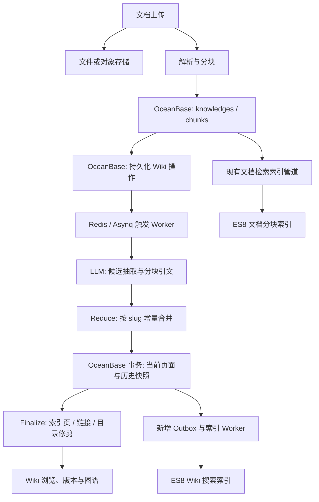

# WeKnora 自动 Wiki：ES8 + OceanBase 4.4.2 替换 PostgreSQL 技术分析报告

日期：2026-10-13（Asia/Shanghai）
读者：项目负责人、架构师、数据库管理员、负责实现与验证的智能体
结论等级：**架构可行，现有代码不能直接配置运行；建议启动有验收门槛的适配 PoC。尚未完成 OceanBase/ES 实机验证。**

## 1. 决策结论

用户的实际约束是公司数据库准入／信创要求，目标数据库版本为 **OceanBase 4.4.2**。本报告暂按 **MySQL 兼容租户**设计；社区版或企业版、具体 BP 补丁、OBProxy 版本、ES8 小版本和公司对 ES 的准入情况仍需部署时确认。若只能使用 Oracle 兼容租户，应重新评估驱动与 SQL，不应照搬本文方案。

推荐方案：

- **OceanBase：唯一业务事实库**，保存知识库、文档元数据、原文分块、Wiki 正文、目录、来源引用、版本历史、问题、权限、任务操作和死信。
- **Elasticsearch 8：可重建的检索投影**，承担文档分块关键词／向量检索；按需新增 Wiki 全文与去重候选索引。
- **Redis：继续保留**，用于 Asynq 任务调度、现有分布式协调和缓存。任务调度不能替代 OceanBase 中的持久化待处理操作。
- **文件／对象存储：继续保留**，保存上传文件、图片等原始资产；ES 和 OceanBase 并不取代这一层。

| 判断项 | 结论 | 依据／条件 |
| --- | --- | --- |
| 自动 Wiki 是否必须依赖 PG 向量库 | 否 | Wiki 开关与向量／关键词开关分离；纯 Wiki 可不配置 embedding 模型 |
| LLM 抽取、引文、Reduce 合并能否保留 | 能 | 主要在 Go 服务与模型调用层，改造重点在 Repository 和事务 |
| ES8 是否已经接入 | 是，限现有文档检索层 | 已有 v8 Repository；Wiki 页面搜索仍走关系库 |
| OceanBase 是否开箱即用 | 否 | 主库初始化只接受 `postgres`／`sqlite`；MySQL 脚本未接线 |
| 改造工作是否只是建表与换 DSN | 否 | 需要方言、持久化队列、软删除唯一性、版本事务与部署改造 |
| 是否需要 Neo4j 才能显示 Wiki 图谱 | 不需要 | Wiki 图谱来自页面链接；另一个 Graph pipeline 属独立能力 |
| 能否立即承诺生产稳定性 | 不能 | 必须在目标 4.4.2 补丁和实际 ES8 上完成故障、并发与性能测试 |

**建议优先实现“自动 Wiki 正确生成与维护”，再完善 ES Wiki 检索，最后按实际规模决定是否把文档向量检索改成 HNSW。** 这样每个阶段都能验证业务价值。ES 可以从第一阶段就部署，但纯 Wiki 的生成正确性不应依赖 ES 是否可用。

PostgreSQL 官方开源版的许可证允许免费商业使用，用户无需因“缺商业授权”本身而迁移；本项目的迁移理由是组织准入。默认 Compose 使用的 ParadeDB 镜像和扩展应与 PostgreSQL 核心分别看待。[PostgreSQL 官方许可证](https://www.postgresql.org/about/licence/)

## 2. 分析基线与证据边界

分析对象：本地 `..`，Git commit：

```text
94fae6de43a36e44d64aecbbdf19c0b72b352aa8
2026-10-13
feat(models): add WeMM embedding presets and Transformers serving (#4238)
```

仓库来源：[Tencent/WeKnora](https://github.com/Tencent/WeKnora/tree/94fae6de43a36e44d64aecbbdf19c0b72b352aa8)。分析前源码工作区干净。Go 模块声明 `go 1.26.0`，GORM `v1.31.1`，ES8 Go 客户端 `v8.19.6`，golang-migrate `v4.19.1`；这些是代码依赖版本，**不等于用户已部署的服务版本**。静态清点发现 PG 侧 119 个 up 迁移文件（最新 000118），SQLite 侧 37 个（最新 000036）；文件数不等于当前活跃表数。

本文依据源码静态阅读和官方文档核对，不包含运行成功的服务、数据库迁移或性能测试。当前终端未找到 Go 命令；没有用户提供的 OceanBase／ES 连接信息。未修改应用代码，也未启动或迁移生产数据库。

下文“现状”表示已从源码确认；“建议”表示未来设计；“待验证”表示不能仅凭 MySQL 兼容声明推断的能力。配套的 `代码依赖清单.json` 提供机器可读定位；`智能体实施任务书-WeKnora-ES8-OceanBase4.4.2.md` 给出任务顺序和验收规则。

## 3. 自动 Wiki 的实际数据链路



这是目标架构，其中 Wiki ES 索引与 Outbox 是**新增项**。

当前管道的主要阶段：

1. 文档解析后保留 `chunks`；即使只开启 Wiki，也需要这些分块回溯来源。
2. `wiki:ingest` 抽取候选实体／概念，逐分块建立引文，再按 slug 合并 Markdown。
3. Wiki 当前内容写入 `wiki_pages`；内容改写前保存旧版本到 `wiki_page_revisions`。
4. `wiki:finalize` 重建索引页、链接和目录；这一阶段主要执行 SQL／图算法，不调用 LLM。
5. `wiki_folders` 是独立目录对象；`folder_id` 是归属依据，路径字段是缓存投影。
6. 删除源文档要撤销来源贡献；删除 KB／租户要清理任务，并阻止新模型调用与旧任务重新写入。

代码入口：[Wiki 功能说明](../website-docs/03-features/14-wiki.md)、[Wiki 生成](../internal/application/service/wiki_ingest.go)、[批处理与 Finalize](../internal/application/service/wiki_ingest_batch.go)、[Wiki Repository](../internal/application/repository/wiki_page.go)。

**能力边界：**自动 Wiki 是有来源支撑、可人工与 Agent 维护的知识页面系统；它不是仅靠替换数据库就能获得的严格本体推理系统。目录、页面链接和独立的实体关系抽取 pipeline 也不应混为一体。

## 4. 已确认的兼容性障碍

| 位置与行为 | 当前实现 | OceanBase 适配要求 | 优先级 |
| --- | --- | --- | --- |
| `container.go:initDatabase`，约 798 行 | 只接受 PG／SQLite，随后还校验 GORM dialect | 接入 MySQL dialector，显式允许 mysql，验证连接与 schema | P0 |
| `database/migration.go`，约 105 行 | 默认 PG 迁移；只为 SQLite 切换目录 | 独立 OB/MySQL 迁移路径与版本状态；验证迁移锁 | P0 |
| `migrations/mysql/README.md` | 明确写明未接线，初始 SQL 仅 10 表 | 不得当成可运行完整 schema；建立当前基线完整迁移 | P0 |
| `wiki_page.go`，约 43／86 行 | `jsonb_array_length`、`'[]'::JSONB` | OB JSON 长度／空值判断；SQL NULL、JSON null、空数组分别测试 | P0 |
| `wiki_page.go:List`，约 355 行 | `to_tsvector`、`plainto_tsquery`、`ILIKE` | OB 字面查询或新增 ES Wiki 搜索；保留分页和计数语义 | P0/P1 |
| 来源反查，约 500／546／828 行 | `source_refs @> ?::jsonb` 和序列化文本 LIKE | 精确引用表优先；临时 JSON 分支须覆盖两种引用格式 | P0 |
| `FindSimilarPages`，约 1049 行 | PG `similarity()`、trigram `%` 操作符 | OB 精确归一化 + Go 相似度；规模扩大后 ES 召回候选 | P0/P1 |
| 归一化标题，约 1090 行 | PG 四参数 `regexp_replace`，另一分支为 SQLite | 在 Go 写入标准化字段，禁止复用 PG 参数顺序 | P0 |
| `SearchAcross`，约 1371 行 | 非 SQLite 一律用 PG `~*` | mysql 独立分支；明确 literal／regex 兼容合同 | P0 |
| `task_queue.go:ClaimBatch`，约 262 行 | 只有 postgres 分支使用行锁；else 假设 SQLite 单写者 | 实现 OB 并发认领；不能直接沿用 else | P0 |
| 队列清空／失败计数，约 401／454 行 | `DELETE/UPDATE ... RETURNING` | 锁定读取 + 修改 + 返回，处于同一事务 | P0 |
| KB 存活检查与 seed，约 69／136 行 | SHARE 锁仅在 PG 分支启用 | OB 使用经验证的锁或更强 UPDATE 锁，统一加锁顺序 | P0 |
| `UpdateWithRevision`，约 116 行 | 快照与 CAS 更新同事务；GORM OnConflict | 保留事务与 RowsAffected 判定，验证 MySQL 冲突语义 | P0 |
| 页面／目录唯一索引 | PG partial unique index，限定未删除行 | 等价的存活唯一性约束，覆盖删除后重建 | P0 |
| `vectorstore.go`、`storagebackend.go` | 删除与绑定保护的一些行锁只对 PG 启用 | 使用 capability 检测，OB 不得失去保护 | P0 |
| `model_usage.go`、`mcp_metadata.go` 等 | 非 PG 分支使用 SQLite JSON 表达式 | 审计所有 fallback；OB 提取字符串用 UNQUOTE，数组长度用 JSON_LENGTH | P0 |
| `chunks`／`knowledge_tags` 的 `seq_id` | PG sequence，SQLite 应用分配；旧 MySQL init 缺失相关覆盖 | DB 分配且并发唯一；检查 ID 回填和迁移后起点 | P0 |
| 原始类型／投影／触发器 | 多处 `type:jsonb`；`chunk_images` 等有 DB 维护投影 | OB DDL、序列化、触发器或等价应用事务投影 | P0/P2 |
| Compose／Helm／迁移脚本 | 默认 ParadeDB，应用 depends_on PG；自建 Langfuse 复用 PG | OB 部署入口、移除 PG 强依赖；单列可选外围组件 | P0 |

代码里已有少量 MySQL 分支，例如 FAQ 查询、`RAND()` 和部分用户行锁；**这不代表主库支持 MySQL 或 OceanBase**。反之，也不能把所有字符串 `ON CONFLICT` 都算作阻塞：GORM clause 通常能转换，真正要审计的是手写 SQL 和转换后的业务语义。

只查 `postgres` 关键字不够；SQLite fallback 也会失败，例如 `json_each`、`json_array_length`、`CAST(... AS TEXT)`。配套清单是静态线索，不是穷尽的调用图或运行覆盖证明。

## 5. 数据与 schema 设计

### 5.1 业务事实保持在 OceanBase

Wiki 核心表包括 `wiki_pages`、`wiki_page_revisions`、`wiki_folders`、`wiki_page_issues`、`task_pending_ops`、`task_dead_letters`。完整工作流还依赖 `tenants`、`users`、组织／权限表、`knowledge_bases`、`knowledges`、`chunks`、`models`、活动审计、向量库与文件存储配置等。

第一版可限制功能，但**不能只创建这 6 张 Wiki 表**。建议生成当前 commit 的完整关系型 baseline，剔除只属于 PG 的 embeddings／扩展／检索索引，保留应用启动和基础 UI 会访问的业务表。未来新增功能按发布版本维护增量迁移，不机械翻译全部 PG 历史迁移。

| PG 类型／能力 | 建议的 OB MySQL 表达 | 需要验证的语义 |
| --- | --- | --- |
| `JSONB` | 原生 `JSON` | 默认值、数组顺序、NULL、参数类型、Scan/Value |
| Wiki／chunk 大段 `TEXT` | `MEDIUMTEXT` 或 `LONGTEXT` | UTF-8 字节大小、严格模式、超长页面不截断；普通 MySQL TEXT 只有约 64 KiB 上限 |
| `TIMESTAMPTZ` | `DATETIME(6)` + 应用统一 UTC | DSN `parseTime`／loc、会话时区、微秒与排序 |
| `BIGSERIAL` | 合适的 `BIGINT ... AUTO_INCREMENT` | 连续性不保证、并发唯一、批量回填；已有 uint64 字段需统一符号约定 |
| PG `BYTEA`／二进制向量缓存 | OB binary/blob 家族 | 长度、空值、序列化；不因此启用 OB 向量索引 |
| PG GIN／trigram／全文索引 | 普通业务索引 + ES 检索投影 | 功能替代可行，但分数、召回和排序不相同 |

OceanBase 4.4.2 文档声明 MySQL 模式兼容 MySQL 5.7 的大部分能力和部分 MySQL 8.0 功能；不能据此假设任意 MySQL8 SQL 及工具链都可直接执行。[兼容模式](https://www.oceanbase.com/docs/common-oceanbase-database-cn-1000000005283144)、[4.4.2 兼容性对比](https://www.oceanbase.com/docs/common-oceanbase-database-cn-1000000005282305)

避免依赖运行时 AutoMigrate 生成全部生产 schema。模型上硬编码的 `type:jsonb`、软删除复合唯一索引与大文本类型须同步调整或做显式方言类型映射；完整的 versioned DDL 才是部署依据。

### 5.2 软删除唯一性

PG 要求“同一 KB 内、未删除的 slug 唯一”；目录要求“同一 KB、同一父目录下未删除的名称唯一”。以下写法均不等价：

- `UNIQUE(kb_id, slug, deleted_at)`：多个存活行的 deleted_at 都是 NULL，通常仍可重复。
- `UNIQUE(kb_id, slug, is_deleted)`：只能保留有限的相同已删状态，反复删除重建会冲突。
- 唯一索引截断 slug／名称前缀：不同完整值可能被错误判为重复。

优先验证生成列方案：存活行 `live_marker=1`，已删行 `live_marker=NULL`，建立完整字段的复合 UNIQUE。必须验证目标 OB 对生成列唯一索引及 NULL 的具体行为，并保证 GORM 插入／更新不写生成列。若不适用，使用独立的“活跃名称占用表”，与创建、删除、重命名同事务维护。

标识符使用与原系统一致的大小写／Unicode 比较规则，不能因为默认 `*_ci` collation 让两个不同 slug 合并。路径 `VARCHAR(1024)`、标题 `VARCHAR(512)` 和 utf8mb4 复合索引有字节长度风险：保留精确唯一键；对仅用于排序的长路径可重设计索引并检验执行计划。**不要套用原生 MySQL 的所有索引长度结论到 OB，按目标版本实际建表结果确认。**

### 5.3 来源引用与链接

建议保留 JSON 字段对外协议，同时增加规范化业务关系：

```text
wiki_page_sources(tenant_id, knowledge_base_id, page_id, knowledge_id, source_title)
wiki_page_chunk_refs(tenant_id, knowledge_base_id, page_id, chunk_id)
```

唯一键至少覆盖 page + source／chunk，来源反查索引覆盖 tenant + KB + knowledge_id。解析现有 `knowledge_id` 和 `knowledge_id|title` 两种形式时复用现有来源解析规则。正文、引用 JSON 与关系表在同一业务事务提交；旧数据回填后双向核对再切换查询。

小规模 PoC 可暂用 `JSON_CONTAINS` + 精确解析 fallback，但序列化 JSON 的 `%LIKE%` 不应成为生产删除／撤销的唯一判据。[OceanBase JSON_CONTAINS 官方说明（4.1，函数语义参考，4.4.2 须再实测）](https://en.oceanbase.com/docs/enterprise-oceanbase-database-en-10000000000867661)

页面链接最初可以继续保留 JSON 与 Go 图算法。需要大量反向查询时再增加 `wiki_page_links` 投影，并覆盖重命名、合并、删除和 Finalize；这不是替换 PostgreSQL 的必要前提。`folder_id` 是逻辑归属关系，源码 DDL 并未以注释中“FK”一词证明存在物理外键，迁移时要检查实际约束。

## 6. 自动 Wiki 的事务与并发保障

### 6.1 页面写入必须保留的合同

当前 `UpdateWithRevision` 已把旧快照插入与 `WHERE id=? AND version=?` 的更新放在同一事务。OB 适配须保持：

1. 两个 writer 读取相同版本，最终只有一个 CAS 成功；失败方必须重新加载并合并，不能直接覆盖。
2. CAS 失败时整个事务回滚，不能留下“仍是当前版本”的历史快照。
3. `(page_id, version)` 保持唯一；重试不产生重复历史。
4. 不能用宽泛 `INSERT IGNORE` 吞掉文本截断、非法值或其他唯一键冲突；GORM MySQL `DoNothing` 的真实 SQL 与 RowsAffected 要实测。
5. 纯 metadata／链接维护目前可能不递增页面 `Version`，必须照顾到现有语义，不能顺便把所有更新改成内容改版。

现有 Redis `withSlugLock` 使用 SetNX 与 TTL，发生 Redis 错误时可继续执行。因此数据库 CAS 是必需的最终防线；新设计不能把“Redis 已锁住”当作数据库一致性证明。若新增租约锁，使用唯一 owner token、续租和 compare-and-delete，过期旧持有者不得删掉新持有者的锁。

### 6.2 任务认领：最关键的 P0

持久化认领的单位是 `(task_type, scope, scope_id, dedup_key)`，通常代表一个知识库内的文档，**不是单行 ID**。同一文档的 ingest／retract 操作必须由同一批次折叠，晚到的同文档操作必须等待当前 claim 结束或变为 stale。

现有 postgres 分支通过 `ROW_NUMBER()` 选每个 dedup_key 的 anchor，再对 anchor `FOR UPDATE SKIP LOCKED`；else 分支依赖 SQLite 单写者。接入 OB 后，必须单独实现并发路径。

推荐 PoC 方案：OB 行锁 + 短事务实现认领，保留既有按 dedup_key 分组的语义。在目标补丁上验证原 anchor SQL、窗口函数、子查询和 `ORDER BY/LIMIT/SKIP LOCKED` 的执行计划及锁范围。OceanBase 官方已有 SKIP LOCKED 锁定查询文档，但本文未取得该具体 4.4.2 BP 的复杂查询行为证明；**语法可执行不等于认领算法正确**。[OceanBase 锁定查询说明（4.2.5，能力参考）](https://www.oceanbase.com/docs/common-oceanbase-database-cn-1000000001500356)

如果 anchor 查询不能可靠工作：新增按 dedup_key 唯一的 claim／lease 表，带 owner token、generation、expires_at，通过 DB 原子条件更新认领，再读取属于该 owner 的明确 op ID 集合。写入、release、delete、renew 必须校验 owner／generation。旧 Worker 租约过期后恢复时不能删除新 Worker 的操作；不能在 LLM 请求期间持有 DB 事务或行锁。

有限规模可采用“每 KB 一个消费者”的 PoC 过渡方案，但要跨实例全局互斥、故障后恢复，并在报告中标明吞吐限制。单进程 mutex 或一个普通事务都不能替代这种互斥。

现有 stale 阈值约 90 分钟。新增心跳／租约可以改善恢复速度，但应作为显式行为变更，结合最长 LLM 调用耗时测试，不能随意缩短后允许旧任务与新任务并发写同一文档。

### 6.3 `RETURNING` 与删除竞态

- `IncrFailCount`：OB 分支在一个短事务中锁定目标行、递增、读取新值；不存在的行保持 `(0,nil)` 行为。
- `DrainUnclaimedAndRelease`：锁定可清理的具体 op ID，排除有 fresh claim 的整组，读取 dedup_key，删除，释放 finalizing 计数；任一失败回滚。
- KB 删除／租户删除与入队／Reduce 要共享清晰的加锁顺序。源文档、KB、租户是否存活都必须在关键写事务内重新确认，避免检查后删除的 TOCTOU。
- 索引、引用表、目录和任务清理要覆盖删除路径。最终不得继续对已删除工作空间调用模型或重建页面。

业务事务建议从显式 READ COMMITTED、强一致主库读取开始验证，并对死锁／序列化冲突做有界事务重试。不得将 LLM 调用包含在自动重试的 DB 事务闭包里。官方文档指出 OB 的隔离实现与原生 MySQL 有区别，特定冲突会要求回滚重试；本文不据另一产品版本文档推定目标租户当前隔离配置。[OceanBase 隔离级别说明](https://www.oceanbase.com/docs/common-oceanbase-database-standalone-1000000006078156)

## 7. ES8：现有能力与需要新增的能力

### 7.1 现有分块检索适配器可复用，但要补工程边界

`retriever/elasticsearch/v8/repository.go` 已提供关键词与向量检索。当前重要特征：

- `VectorRetrieve` 使用 `Math.max(cosineSimilarity(...),0.0)` 的 `script_score`；对过滤后候选逐个计算，计算量随候选数和维度增长。
- `createIndexIfNotExists` 创建空索引，没有显式字段 mapping；ID 字段会通过 `.keyword` 兼容检测。
- Save 与 Bulk 路径没有设置稳定业务 `_id`；重复写入会产生多个 ES 文档的风险。
- Bulk 已检查响应内逐项错误，不能重复把“HTTP200 未处理”的问题当成现状缺陷。
- 基础过滤含 KB／文档／标签与禁用 chunk；现有 ES 文档没有独立 tenant_id 字段，依赖上游授权与 scope。新增索引应显式保存 tenant_id，但共享 KB 查询不能简单限定为调用者租户。
- 构造器遇到建索引失败只记录日志后继续；生产需要健康／能力检查，避免把不能检索的实例当作正常实例。

建议显式 mapping：ID 为 keyword、tenant_id 为按统一协议表示的精确字段、正文为 text、向量为 dense_vector、业务时间为 date、删除／状态字段显式化。按 embedding model + dims + mapping_version 隔离物理索引，同维度但不同模型也不能混用；别名连接逻辑索引与当前物理版本。

现有客户端 `v8.19.6` 优先匹配经过验证的 ES8 服务版本。不能把“ES8”理解成 8.0 与 8.19 完全一致。ES8.19 dense_vector 文档的维度上限为 4096，若模型输出更高维度必须另选模型或有经验证的降维方案；这不是整个 ES8 系列统一保证。[ES8.19 dense_vector](https://www.elastic.co/guide/en/elasticsearch/reference/8.19/dense-vector.html)

中小规模可先保留 script_score。规模扩大后才改为 HNSW kNN，在 knn 内使用授权 scope 的前置 filter，保留禁用／删除过滤；用真实问题集评估 Recall@K、延迟和阈值。kNN cosine `_score` 与当前 clamp cosine 分数不相同，迁移后必须重新标定 Threshold。[kNN filter 说明](https://www.elastic.co/guide/en/elasticsearch/reference/8.19/query-dsl-knn-query.html)

`search.allow_expensive_queries=false` 会禁用 script_score，这应纳入 PoC 配置检查。显式映射为 HNSW 也不会自动改变现有 Go 查询路径。[script_score 官方说明](https://www.elastic.co/guide/en/elasticsearch/reference/8.19/query-dsl-script-score-query.html)

现有 ES Save 要求非空 embedding，且 WeKnora 当前 `NeedsEmbedding()` 把关键词管道也算入需要 embedding 的路径。**纯 Wiki 可无 embedding；现有关键词检索路径不能据 ES 本身支持 BM25 就宣称无需 embedding。** 若希望低成本 keyword-only，需要单列改造需求。

### 7.2 Wiki 页面搜索必须另接

`RETRIEVE_DRIVER=elasticsearch_v8` 不会改变 `wikiPageRepository.SearchAcross/List/FindSimilarPages`。建议新增专门的 Wiki 搜索接口和 ES 索引：

```text
wiki-pages-v1
  tenant_id, knowledge_base_id, page_id, slug
  title, title_normalized, aliases, summary, content, page_type, status
  source_knowledge_ids, index_generation, deleted, updated_at
```

标题／别名的精确和归一化字段，与中文全文字段分别映射。中文 analyzer 的选择按公司批准的组件确定；用中文、英文缩写、标点名称和混合语言样例评价效果。ngram 候选索引可用，但长度下限会影响单字／短名字，应补精确查询。

保留搜索入口的语义差异：页面列表的全文 Query、Wiki HTTP 搜索和 Agent `wiki_search` 不完全相同。当前 Repository SearchAcross 使用正则 `~*`；Agent 搜索还包含 Go 层的 regex／literal 处理，文档与实际搜索字段可能存在差异。迁移前以现有调用方与测试为准写兼容矩阵，不能直接用一个 `multi_match` 替换所有搜索行为。

正则可采用 Go 层受限过滤，明确语法、超时与候选范围；只有召回集合完整时才可承诺全库正则兼容。ES regexp 基于 term，与对整个正文的 POSIX／Go 正则不同；不能只换操作符。新增 aliases 搜索或排序调整要标明产品行为变化。

### 7.3 去重候选不等于最终合并决定

OB 维护 `title_normalized`，复用现有 Go identity 规范化，优先找精确匹配。ES 对 title／aliases ngram 召回相似候选，随后用现有 Go 相似度筛选与 LLM 去重流程判断。PG trigram 分数、ES BM25 分数和 Go bigram 分数不同，不共用阈值。

生成时优先检查 OB 内刚写入的同名／归一化页面，再查 ES 候选；ES 延迟不能造成同一实体在一个批次中重复建页。ES 不可用时必须有 OB／Go fallback 或暂停可重试的去重步骤，不能静默“无候选”并大量创建重复实体。

### 7.4 一致性：需要事务 Outbox 与单调索引代际

页面写入不能同步双写后假定跨系统原子。推荐：

1. OB 同一事务保存页面、快照、关系投影及 `search_index_outbox` 事件。
2. Worker 读取事件后按 page_id 从 OB 加载最新状态，写稳定 `_id` 到 ES；失败重试，超过上限入死信。
3. 对每页维护独立的、每次影响检索状态都递增的 **index_generation**。页面 `Version` 只表示内容历史，不能兼任索引代际；改链接／来源／状态的某些写路径不升 Version。
4. 以 external version 或等价幂等 CAS 协议拒绝迟到旧事件；重试同代际须明确 external／external_gte 语义。不同物理索引建立时保留代际。
5. 删除写更高代际的 tombstone；不能依赖 ES 物理删除的短期版本记忆阻止迟到旧 upsert。tombstone 安全清理须晚于所有可能重放窗口，或统一以 OB 当前存活状态进行写入判定。
6. 查询命中要在 OB 回读校验页面状态与访问权限；UI 正文、编辑、回滚、来源撤销均以 OB 为准。
7. 定期按 checkpoint 全量／增量重建并比较数量、状态和 hash；ES 丢失可从 OB 恢复，embedding 是否可直接复用取决于是否持久保存了向量缓存，否则重嵌入有费用。

对编辑后的立即回读直接访问 OB。若要求立即可搜索，可对少量用户操作设置 `refresh=wait_for` 或临时 OB fallback；批量摄入不要逐页强制 refresh。ES pending／error 状态不能复用为 Wiki 生成失败，运营上分开观察。

## 8. 主库接线与迁移策略

建议第一版 `DB_DRIVER=mysql`，以 OceanBase MySQL tenant 连接；GORM `Dialector.Name()` 实际仍是 `mysql`。可以额外增加产品标识／能力配置，但不能伪装为 postgres／sqlite 以绕过原校验。

接线事项：

- 加入 `gorm.io/driver/mysql`；现有 `go-sql-driver/mysql` 是给 Doris 使用，不能证明 GORM 主库已经接入。
- DSN 用驱动配置结构生成，覆盖特殊字符、租户登录名、OBProxy／直连、parseTime、UTC、TLS；不打印密码。
- 不依赖驱动读到 server version 就能准确判断 OB 的所有能力；显式设置／探测 RenameIndex、JSON、锁、RETURNING 等 capability。
- 新增独立迁移目录，例如 `migrations/oceanbase/`。记录 baseline 源 commit 与 schema 对照清单，勿把 OB 迁移数字强行映射成 PG 迁移数字。
- 当前应用迁移失败后可 warning 并继续启动；OB 部署应失败退出，或外置迁移并在应用启动时严格验证 schema version。否则 UI 启动不代表数据库可用。
- 独立 migrator Job／命令执行 DDL，应用实例 `AUTO_MIGRATE=false`；必须提供防并发的部署控制及版本校验。

golang-migrate `v4.19.1` MySQL 驱动调用 `GET_LOCK`／`RELEASE_LOCK`，且 SetVersion 使用 Serializable 事务。目标 OB 对命名锁的支持与 OBProxy 会话行为必须实测；本文**没有认定 4.4.2 一定不支持 GET_LOCK**。如不适用，用外部单实例迁移锁或 OB 专用实现；仅在有可靠外部互斥时考虑 `NoLock`，不能让所有 Pod 无锁 auto migrate。[对应版本源码](https://raw.githubusercontent.com/golang-migrate/migrate/v4.19.1/database/mysql/mysql.go)

PoC 先针对新安装建立完整 baseline。如果已有 PG 业务数据：停止写入与消费，导出业务表／引用／快照，保留原 UUID、版本和时间，导入 OB，校验引用及序号起点，从 OB 重建 ES，再恢复消费。跨库不中断双写迁移另成项目，不能包含在“改 DSN”范围里。

## 9. 实施范围与建议阶段

| 阶段 | 交付 | 退出条件 |
| --- | --- | --- |
| P0-A：兼容探针 | 目标 OB／ES 能力矩阵、schema inventory、基础连接 | 明确 BP、租户模式、驱动与 migrator 路线；建表、锁和 JSON 无未决阻塞 |
| P0-B：主库与 Wiki PoC | OB baseline，核心 Repository，持久化队列，Wiki 编辑／回滚／删除 | 不启动 PG 仍能完成文档→Wiki→来源回读闭环；故障恢复、并发不破坏数据 |
| P1：ES Wiki 检索 | 独立 Wiki 搜索接口、mapping、Outbox、重建与去重 fallback | ES 断连、重放、删除、乱序测试通过；搜索正确性与延迟达到约定目标 |
| P2：规模与完整产品 | HNSW（按需）、完整可选模块、国产平台部署、性能与运维 | 功能覆盖报告、压测与备份恢复通过，升级迁移经过演练 |

初步工作量仅供预算：熟悉 Go/GORM 的工程师加 DBA，已有测试集群时，Wiki PoC 约 **10–20 人日**；加上检索一致性、全产品方言覆盖、生产故障与升级验证，约 **30–60 人日**。两阶段范围有重叠，不应相加。旧数据在线迁移、Oracle 模式、复杂认证和国产芯片构建可能显著增加工作量。估算不是实测进度承诺，应在 P0-A 后重估。

ES8 和 OB 并不自动代表整个系统满足信创要求：还要落实 Redis、模型推理／外部接口、对象存储、docreader/OCR、容器镜像及国产 CPU／OS 的准入。仓库自建 Langfuse 配置仍使用 PG；首版可关闭该可选栈或接入获准的独立服务，不宣称 Langfuse 已随主库改造迁移到 OB。ES 默认发行版许可证与订阅功能也需满足公司的既有准入条件。[Elastic 官方许可 FAQ](https://www.elastic.co/pricing/faq/licensing)

## 10. 验收与否决门槛

### 必须通过的正确性测试

| 场景 | 通过标准 |
| --- | --- |
| 两篇文档描述同一实体 | 合并后内容与全部有效来源存在；同 KB 无重复存活 slug |
| 并发更新同一 Wiki 页 | 只有一个相同 expectedVersion 的 CAS 成功；历史无孤立／重复快照 |
| 同文档多个 op 与晚到 retract | 同 dedup_key 不被两个有效 claim 同时处理，最终删除贡献不被旧 ingest 恢复 |
| Worker 在 claim／页面提交／ack 前崩溃 | 操作可恢复，重复执行幂等；pending_subtasks 不永久卡住或出现负数 |
| 源文档删除 | JSON 与引用表同步撤销，保留其他有效文档贡献，来源回读不返回已删内容 |
| KB／租户删除与 Reduce 竞争 | 删除后无新模型请求，无页面／任务复活，无权限泄漏 |
| 编辑／Agent 更新／版本回滚 | 版本递增、作者与快照正确，失败事务完全回滚 |
| 页面、目录反复删建 | 存活唯一性正确，允许合法历史与大小写规则 |
| JSON／Unicode／长内容 | 空数组、JSON null、SQL NULL、中文、emoji、引号、百分号、反斜杠正确；大于64KiB页面不截断 |
| ES 不可用／重放乱序 | OB 业务数据完整，恢复后最终收敛；旧事件不覆盖新代际，删除不复活 |
| 权限共享 | 共享 KB 可按授权访问，非授权 KB 不可访问；所有 API／Agent／MCP 路径一致 |
| 完全无 PG 部署 | 所有声明启用的核心路径不连接 PG、不执行 PG 扩展或 SQL；禁用模块有明确说明 |

测试先用确定性模型 stub 控制输出与失败，再用少量真实 LLM 评估 Wiki 质量和费用。SQLite 单测通过不能证明 OB 多 Worker 正确；数据库并发测试要使用目标版本真实实例。

### 建议性能门槛（待业务确认，并非测得结果）

- 第一组：1,000 文档、10,000 Wiki 页；第二组：10,000 文档、约 40,000 Wiki 页。两组为压测负载，不假设文档与页面固定比例。
- 普通目录／页列表与精确读取 p95 ≤ 300ms；常用 Wiki 搜索 p95 ≤ 1s。
- 正常负载下 ES 索引可见延迟 p95 ≤ 5s，断连后 backlog 可以按约定恢复窗口排空。
- 2／4／8 Worker、2 应用实例下测队列吞吐、锁等待、重复执行与 LLM 并发控制。
- 向量检索启用时记录候选数、dims、p95、Recall@K；达到容量瓶颈后才要求 HNSW。
- LLM 耗时与 DB／ES 延迟分别计量。生成成本按抽取＋逐块引文＋Reduce＋失败重试计算，不按“每文档一次模型请求”估算。

**Go／No-Go：**基础 DDL、活跃唯一性、页面版本事务、任务分组认领、删除竞态任一不正确，不进入生产。ES 排名与阈值若未验证，只能作为限范围 PoC；全库去重若依赖过期索引且无 fallback，也不能承诺生产质量。

## 11. 给项目负责人的最终建议

在你明确的组织准入约束下，**ES8 + OceanBase 4.4.2 MySQL 模式值得实施 PoC，自动 Wiki 的核心能力可以保留**。将项目定义为“新增主库方言支持＋Wiki 检索投影”，而不是“PostgreSQL 配置替换”。

先用 OB 跑通一套可恢复、可追溯的 Wiki，再把 ES 作为检索加速器接上。开工的首个交付应是目标集群上的能力探针与并发测试结果；通过本文 P0 门槛之后，才把结论从“可行”升级为“可部署”。具体执行交接见配套任务书。
